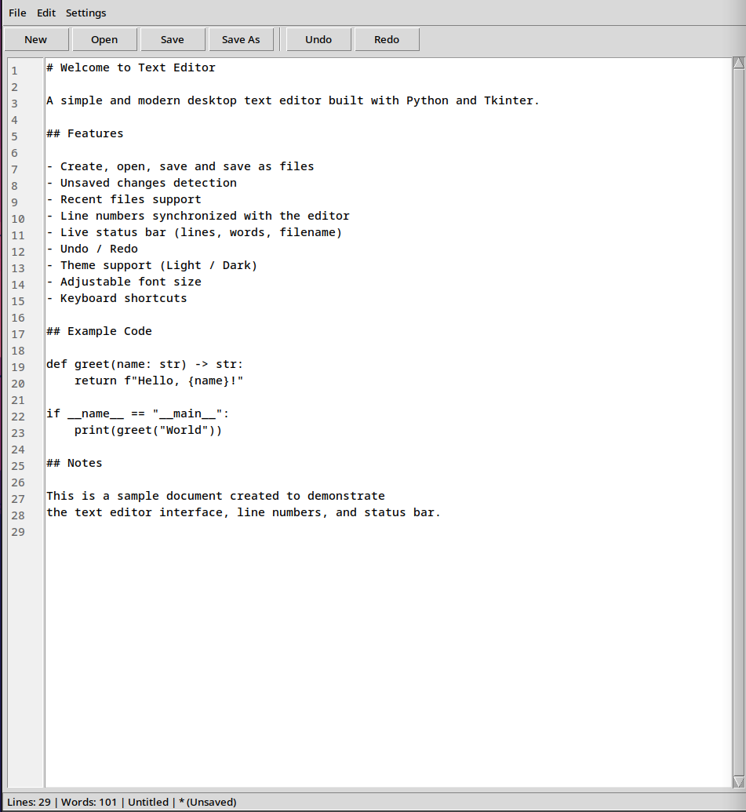

# Text Editor

A simple, lightweight desktop text editor built with Python and Tkinter. No third-party dependencies — just the Python standard library.



## Features

- **File operations**: Create, open, save, and save-as files (UTF-8)
- **Unsaved changes detection**: prompts before closing or switching files
- **Recent files**: last 10 opened files, persisted across sessions in `~/.text_editor_config.json`
- **Line numbers**: synchronized with the editor scroll position
- **Live status bar**: line count, word count, current filename, and unsaved indicator
- **Undo / Redo**
- **Themes**: Light, Dark, and System Default
- **Adjustable font size**: 8–24
- **Clean UI**: menu bar and toolbar

## Requirements

- Python 3.8+
- Tkinter (included with Python on most platforms; on Debian/Ubuntu install it with `sudo apt install python3-tk`)

## Getting Started

1. Clone the repository:

    ```bash
    git clone https://github.com/Wayfarerdesert/text-editor.git
    cd text_editor
    ```

2. Run the editor:

    ```bash
    python textEditor.py
    ```

## Keyboard Shortcuts

| Shortcut | Action |
|---|---|
| `Ctrl+N` | New file |
| `Ctrl+O` | Open file |
| `Ctrl+S` | Save |
| `Ctrl+Shift+S` | Save As |
| `Ctrl+Q` | Quit |
| `Ctrl+Z` | Undo |
| `Ctrl+Shift+Z` | Redo |
| `Ctrl+X` / `Ctrl+C` / `Ctrl+V` | Cut / Copy / Paste |


## Configuration

Recent files are stored in `~/.text_editor_config.json`. The theme and font size are not persisted and reset on restart.

